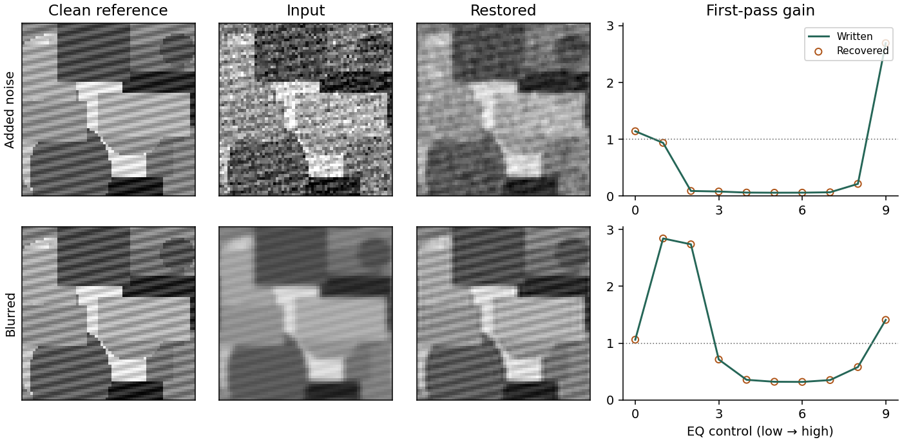

# SighImageX

**An image writes its own ten-band EQ. Can an observer measure the curve it wrote, then predict the next one?**

Open **[index.html](index.html)** locally. This single offline file includes both trained models. Switch the same lighthouse or your own photo between added noise and blur. Reveal either pass's written curve and compare it with the orange points measured from the layer's boundary images. **Scramble phase** rearranges the picture while preserving its Fourier magnitudes. **Inject checkerboard** changes one Fourier mode. **Flat field** shows which controls the observer can actually see.



## What the model learned

We chose paired restoration for the first experiment. The same clean scene appears twice, once with additive white noise and once with Gaussian blur plus a little noise. A successful model must suppress fine-scale energy in one case and recover some of it in the other. The writer gets the corrupted image alone. The training objective is pixel MSE against the clean image, with no filter curves or corruption labels supplied to the learned model.

Mean squared error in grayscale intensity units (nominal range −1 to +1). Lower is better. The first two numeric columns average three training runs on the same 64 held-out scenes per corruption. The last two columns use the seed-17 model on 72 non-overlapping crops of a single held-out photograph, Matplotlib's Grace Hopper sample. The crops share a subject and the same simulated degradation family.

| Method | Synthetic noise | Synthetic blur | Photo noise | Photo blur |
|---|---:|---:|---:|---:|
| Input | 0.08704 | 0.01373 | 0.08924 | 0.00876 |
| Trained fixed two-pass EQ | 0.02217 | 0.01780 | 0.01862 | 0.01208 |
| Two specialist filters + energy threshold | 0.02011 | 0.00696 | **0.01634** | 0.00428 |
| SighImageX | **0.01986** | **0.00643** | 0.01640 | **0.00419** |

The fixed EQ actually made the blurred test images worse. The adaptive EQ handled both conditions. A simpler baseline came close. It fits two ten-control linear least-squares filters using known corruption labels, then selects between them by the high-band energy of a new image. Its threshold was fitted on a separate calibration batch. The tiny photo differences do not establish a general restoration advantage. Replacing the learned per-image curves by their calibration means raised synthetic MSE to 0.07485 (noise) and 0.01102 (blur).

## The two passes

Each pass reads the current 64 × 64 grayscale field. The 2D FFT is fixed. The ten overlapping radial basis functions use the original Sigh lookup: normalized **squared** radius, floor to a 256-entry table, and linear interpolation of ten control gains. Periodic boundaries are used throughout.

1. Measure the mean squared Fourier magnitude under each basis function using an orthonormal FFT.
2. Feed the ten unsigned features, log(1 + energy / 0.01), into an affine writer followed by a sigmoid. It produces ten gains between 0.05 and 3. Each pass has its own writer. In total there are 220 trainable scalars.
3. Multiply the input spectrum by the interpolated gain, then transform back. Apply the invertible pointwise bend asinh(0.65 z) / 0.65.
4. Mix 0.88 of that field with 0.12 of the **original corrupted image**. This is Sigh's fresh-input recursion. Repeat with the second writer.

The first writer sees identical features for pictures with identical Fourier magnitudes, even when their spatial structures differ. Phase remains in the signal being filtered. The pointwise bend can make the second pass's energies phase-sensitive. Each pass uses one global radial curve, so it has no separate local addresses for, say, eyes and background.

## Two inverses and one intervention

**Read the curve.** The observer receives the original corrupted image, a layer's entering image and its leaving image. It knows the grid, EQ basis, bend and skip. It removes the known skip and inverts the bend. A weighted spectral least-squares fit recovers the ten gains, with a null-space check for unsupported controls. The probe receives no writer weights. On 32 fresh images the worst gain discrepancy across both passes was **2.6 × 10⁻¹⁴**. On a constant image only the DC control was identifiable. The browser uses a conservative conditioning threshold for its small normal-equation solver. The Python assay uses direct SVD.

**Read the writer.** On 96 calibration inputs we used the *recovered* gains and observed band energies to fit a second writer in the declared affine-logistic family. Its gain RMSE against the hidden writer on 32 new images was **3.4 × 10⁻¹⁵** and **3.7 × 10⁻¹⁵** for passes one and two. Substituting one mean curve per pass gave **0.625** and **0.282**. This is identifiable behavior under known representation and clean intermediate access. Recovering arbitrary hidden stages from the final rendered picture alone is an open problem here.

**Locate the writer's effect.** Add a checkerboard of amplitude 0.12, changing one Fourier mode. Run the edited input twice, once normally and once with its *previous* first-pass curve frozen. Undo the bend and skip in both results, remove the edited Fourier mode, and measure the difference over all other modes. Its RMS was **0.0417** for the adaptive model and **0** for the fixed model. The perturbed input was identical in the two replays. The surviving difference measures the effect of rewriting the filter. As a separate control, randomizing phase while preserving magnitudes changed the first-pass gains by at most **4.5 × 10⁻¹⁶**.

## Is the idea new?

Input-dependent Fourier filtering for vision has clear prior art. Huang et al. used adaptive frequency filters for global token mixing in AFFNet (ICCV 2023). Tatsunami and Taki developed FFT-based dynamic filter vision models in DFFormer (AAAI 2024). Power-spectrum-based image restoration also has a long history. [AFFNet paper](https://openaccess.thecvf.com/content/ICCV2023/papers/Huang_Adaptive_Frequency_Filters_As_Efficient_Global_Token_Mixers_ICCV_2023_paper.pdf) · [DFFormer paper](https://arxiv.org/abs/2303.03932) · [Digital Image Restoration](https://www.csd.uoc.gr/~hy371/bibliography/ImageRestoration.pdf)

SighImageX makes a narrower engineering contribution. The image writes ten inspectable gains, a second instrument measures which of those gains the image constrains, and a one-frequency edit tests whether rewriting changes other frequencies. We have not established priority for this combination. The demonstration is small enough to rerun, and the model's phase blindness can be experienced directly.

For the transformer analogy, the DFT exactly diagonalizes circular convolution. A finite causal attention matrix generally has boundaries, content-dependent entries and row normalization. RoPE supplies oscillatory terms to query–key scores across displacement. In this model the gain actually multiplies image Fourier coefficients. These are two different uses of frequency.

## Run

The inference page requires only a browser. Training runs on a CPU with Python and NumPy. Run from the repository root.

```sh
python -m pip install numpy
python experiment.py
python -m unittest discover -s tests -v
python build.py
node tests/demo.cjs
```

Small FFT batches benefit from a single BLAS thread. In Windows Command Prompt, use `set OPENBLAS_NUM_THREADS=1` before training. Seeds 17, 29 and 41 each use 240 Adam steps with batches of four independently generated clean scenes each shown under both corruptions. The fixed control gets the same data order and optimizer. Curves and pixel metrics use unclipped floats. A shared clipped display range is applied only when drawing the images.

For the optional photo check and figure, install `pillow matplotlib`, then run `python photo_check.py` and `python figure.py`. [Training and audit receipt](results/receipt.json) · [Photo receipt](results/photo.json) · [Reference checkpoint](results/weights.json) · [Independent boundary probe](probe.py)

The JavaScript tests run the bundled UI handlers in a DOM stub and check both layers against a Python reference. Python tests cover gradient propagation through both writers, recovery of an independently chosen curve, unsupported bands and an out-of-family residual.

## Family

[SighImageInverse](https://github.com/anttiluode/SighImageInverse) supplied the radial EQ convention, the browser FFT (MIT) and the question of dark bands. [BlackBoxSpotlight](https://github.com/anttiluode/BlackBoxSpotlight) supplied the idea of fitting through an observation boundary and revealing the internal answer afterward. [Luotain2](https://github.com/anttiluode/luotain2) supplied the held-out test discipline.
